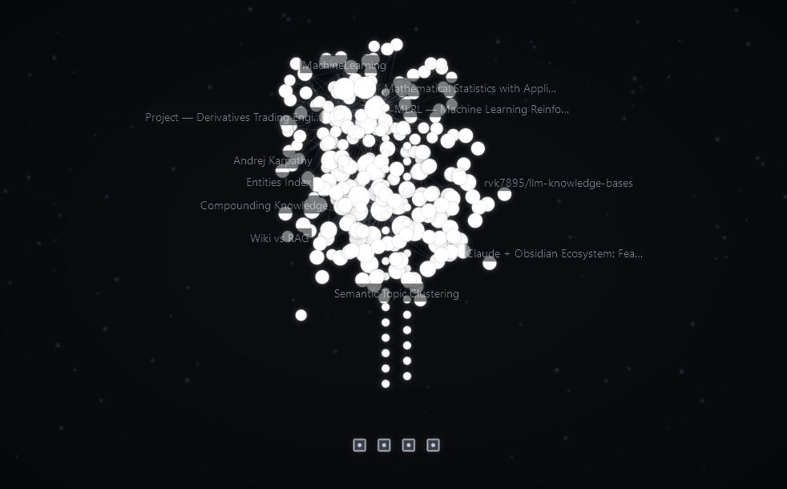
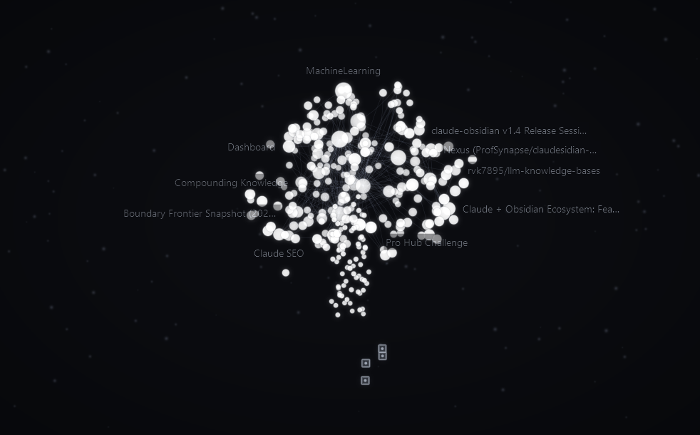
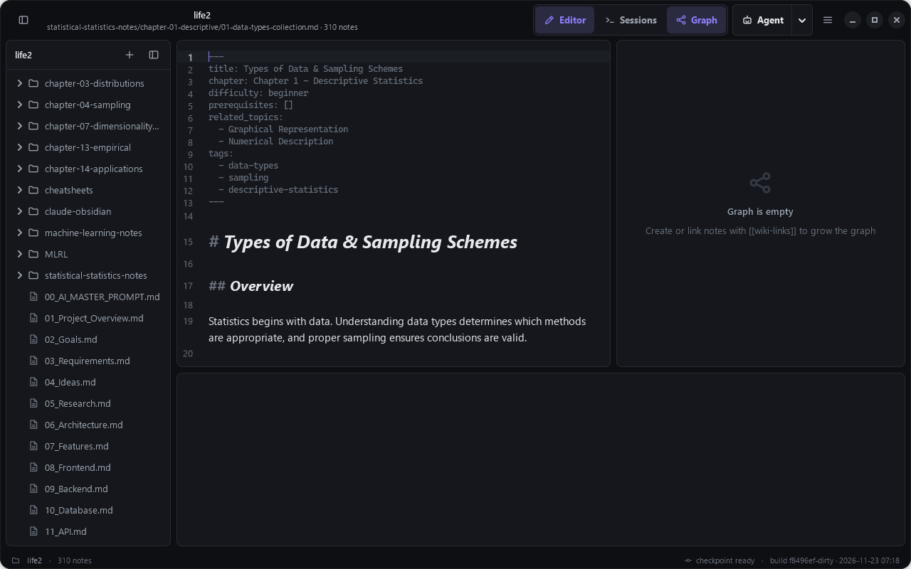
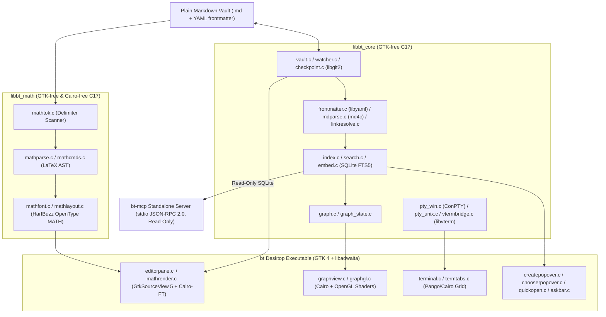

# BrainTerm

[](https://en.cppreference.com/w/c/17)
[](https://gtk.org/)
[](https://mesonbuild.com/)
[](https://github.com/rizawn/BrainTerm)
[](https://github.com/rizawn/BrainTerm)

> **"My notes are the AI's memory, my terminal is the AI's hands, my graph is the map of my brain."**

**BrainTerm** is a local-first, plain-Markdown knowledge workspace and second brain built in **C17 + GTK 4 + libadwaita**. It combines a live-preview Markdown editor (with clickable wiki-links and auto-compiling LaTeX math), an embedded real terminal (Windows ConPTY / POSIX PTY + `libvterm`), a SQLite FTS5 memory index, an interactive 2D/3D brain-shaped knowledge graph, `libgit2` safety checkpoints, and a standalone read-only MCP memory server (`bt-mcp`).

Repository: [https://github.com/rizawn/BrainTerm](https://github.com/rizawn/BrainTerm)

---

## Overview

Most knowledge tools either keep notes isolated from developer workflows or rely on proprietary cloud databases and webview wrappers. BrainTerm is designed for technical users who keep plain Markdown notes and work daily with terminal-based AI coding agents (`claude`, `codex`, `gemini`).

### Core Principles

1. **Local-first & Plain Markdown** — Every note is a standard `.md` file with YAML frontmatter on disk. There is no cloud sync dependency and no proprietary lock-in.
2. **Derived Index as Cache** — SQLite (`vault/.bt/index.db`) and the graph are derived caches that can be deleted and rebuilt automatically from the Markdown files at any time.
3. **Human vs. AI Separation** — Human-authored fields (`source: human`, `tags`) are structurally separated from AI-proposed metadata (`tags_ai`) and AI prose (`## AI draft`). Human-locked fields are never overwritten by automation.
4. **Terminal-first AI Execution** — Instead of building a custom chat UI, BrainTerm embeds a real PTY terminal rooted at the vault directory so existing CLI agents can run natively with full vault context.
5. **Reversible Automation** — Automatic `libgit2` checkpoints are created before agent or organizer write batches so changes remain inspectable and reversible.

---

## Features

### Implemented

- **Vault & Atomic Storage**
  - Fast plain-Markdown vault scanner with ignore rules and `vault_resolve()` path containment guard.
  - Atomic writes with `.md.tmp` crash recovery and `GFileMonitor` external-change detection with a non-destructive conflict banner (`Review diff`, `Keep mine`, `Reload`).
- **Markdown Editor (`GtkSourceView 5`)**
  - Custom `bt-markdown.lang` syntax highlighting, live-preview styling (`Inter` / `JetBrains Mono`), centered reading column, and `1 s` debounced autosave.
  - **Clickable Links (L1–L3):** Single-click or `Ctrl+Click` navigation for `[[wikilinks]]`, Markdown links, headings (`#anchor`), local files, and external URLs. Includes a create-note preview popover for unresolved targets, an ambiguity chooser popover for duplicate note names, keyboard link navigation (`Ctrl+Alt+Left/Right`, `Ctrl+Enter`), history navigation (`Alt+Left/Right`), credential-stripping warnings, and a configurable external URL confirmation toggle.
  - **Live Auto-Compiling LaTeX Math (M1–M5):** Built-in LaTeX subset parser, HarfBuzz OpenType `MATH` layout engine (`STIXTwoMath-Regular.otf`), and Cairo-FreeType renderer. Formulas (`$...$` and `$$...$$`) auto-compile in place when the cursor leaves the span or when pressing `Enter`/`Esc`, while clicking a formula reveals raw LaTeX with a floating live preview. Underlying Markdown files remain unmodified plain LaTeX.
- **Embedded Real Terminal**
  - Multi-tab terminal (up to 8 tabs) backed by Windows ConPTY (`CreatePseudoConsole` + Win32 Job Object `KILL_ON_JOB_CLOSE`) and POSIX `forkpty`, `libvterm` emulation, 10,000-line scrollback ring, scrollback search (`Ctrl+Shift+F`), and bracketed paste.
  - One-click detection and sanitized launch for `claude`, `codex`, and `gemini` CLIs with `TERM_PROGRAM=brainterm` and `BT_ACTIVE_NOTE` context.
- **Memory Engine, Search & Importers**
  - SQLite FTS5 full-text index with external-content triggers, schema migrations (`migrations/0001_init.sql`, `migrations/0002_links_resolution.sql`), and automatic corruption rebuild.
  - Unified Quick Open (`Ctrl+P`) and Ask / Search / Command bar (`Ctrl+E`).
  - Auto-organizer with deterministic no-AI rules backend (default) and human-lock protection.
  - Built-in idempotent importers for ChatGPT, Claude, Claude Code, and Codex history, plus optional offline embeddings and RRF hybrid search.
- **Interactive Brain Graph (2D & 3D)**
  - Every `.md` file maps to one node, with ghost nodes for unresolved links, brainstem/cortex layout, filtering, and dual Cairo / OpenGL (`GtkGLArea` + GLSL shaders) rendering.
- **Standalone Read-Only MCP Server (`bt-mcp`)**
  - Stdio JSON-RPC 2.0 server exposing `search_memory`, `ask_memory`, `recent`, and `get_note` against `vault/.bt/index.db` opened strictly read-only.

### In Development / Unverified

- Interactive Linux (`pty_unix.c`) manual desktop verification (currently compiled and tested via Ubuntu GitHub Actions CI).
- Windows IME composition testing (CJK / dead-key layouts) in `GtkSourceView 5` and the embedded terminal.
- Further math layout polish for complex multi-line display environments and custom font sizing controls.

### Planned

- Export pipelines (compiled Markdown/HTML/PDF with rendered math).
- Linux AppImage / Flatpak packaging alongside the Windows portable bundle.

---

## Preview

| Brain Graph (2D Default Fit) | Brain Graph (3D Mode) |
|---|---|
|  |  |

| Editor & Clickable Links Split View |
|---|
|  |

---

## Architecture

BrainTerm is structured into a UI-independent core static library (`libbt_core`), a GTK/Cairo-free math engine (`libbt_math`), a native GTK 4 desktop shell (`bt`), and a standalone headless MCP server (`bt-mcp`).



### Component Responsibilities

- **`src/math/` (`libbt_math`):** Pure C17 math pipeline (`mathtok` → `mathparse` → `mathfont` → `mathlayout`) using GLib and HarfBuzz `<hb-ot.h>` only, with strict untrusted-input bounds (4 KB inline, 16 KB display, depth 64, 5,000 AST nodes).
- **`src/` (`libbt_core`):** Vault filesystem operations, path containment, atomic writes, git checkpointing, YAML/Markdown parsing, link resolution, SQLite FTS5 indexing, graph topology, PTY management, and AI CLI session tracking.
- **`src/ui/` (`bt`):** GTK 4 / libadwaita widgets, theme/font loader, `GtkSourceView 5` editor with in-place Cairo-FreeType math rendering (`mathrender.c`), Cairo/OpenGL graph viewports, and terminal tabs.
- **`src/mcp/main.c` (`bt-mcp`):** Zero-GTK executable exposing read-only vault search and note retrieval over JSON-RPC 2.0 stdio.

---

## Tech Stack

| Category | Technologies |
|---|---|
| **Language** | C17 (`-std=c17 -Wall -Wextra -Wpedantic -Wshadow -Wformat=2`) |
| **UI Framework** | GTK 4 (`>= 4.10`), libadwaita (`>= 1.4`), GtkSourceView 5 (`>= 5.4`), GLib / GIO (`>= 2.74`) |
| **Graphics & Math** | Cairo, FreeType 2, HarfBuzz (`>= 4.0`, OpenType `MATH`), libepoxy (OpenGL shaders), Pango |
| **Terminal** | Windows ConPTY / POSIX `forkpty`, `libvterm` (`>= 0.3`) |
| **Parsing & Storage** | SQLite 3 (FTS5), `libyaml`, `md4c`, `cJSON`, `libgit2` |
| **Bundled Fonts** | Inter (`InterVariable.ttf`), JetBrains Mono (`JetBrainsMono-*.ttf`), STIX Two Math (`STIXTwoMath-Regular.otf`) |
| **Build & Test** | Meson (`>= 1.1.0`), Ninja, GCC (MSYS2 UCRT64 on Windows / native GCC on Linux), CMocka, Python 3 |

---

## Project Structure

```text
BrainTerm/
├── .github/workflows/ci.yml   # Windows (MSYS2 UCRT64) & Ubuntu CI pipeline
├── data/
│   ├── brainterm.gresource.xml
│   ├── theme.css              # Dusk dark/light application stylesheet
│   ├── fonts/                 # Bundled Inter, JetBrains Mono, STIX Two Math + OFL licenses
│   ├── icons/                 # Custom symbolic SVG icons
│   ├── language-specs/        # bt-markdown.lang (GtkSourceView 5 spec)
│   ├── shaders/               # GLSL vertex/fragment shaders for OpenGL graph view
│   └── styles/                # bt-ink-dark.xml and bt-ink-light.xml editor schemes
├── docs/                      # Architecture spec (project.md), ADRs (DECISIONS.md), plans & evidence
├── migrations/                # SQLite schema migrations (0001_init.sql, 0002_links_resolution.sql)
├── scripts/
│   ├── gen_build_stamp.py     # Generates git commit + timestamp build stamp header
│   ├── gen_icons.py           # Icon generation helper
│   └── package-win.ps1        # Lock-safe atomic Windows bundle packager + smoke test
├── src/
│   ├── math/                  # libbt_math: tokenizer, LaTeX parser, OpenType MATH layout
│   ├── mcp/                   # bt-mcp standalone read-only MCP stdio server
│   ├── ui/                    # GTK4 widgets: editorpane, mathrender, graphgl, termtabs, popovers
│   └── *.c / *.h              # libbt_core: vault, index, search, graph, pty, checkpoint, importers
├── tests/
│   ├── bench/                 # Performance benchmarks (scan, search, graph, vterm, createnote)
│   ├── crash-rig/             # Atomic write crash recovery rig
│   ├── fixtures/              # Test vault fixtures
│   ├── unit/                  # CMocka unit & GTK UI test suites
│   └── vtcorpus/              # Terminal VT conformance tests
├── vault-template/            # Starter vault files (AGENTS.md, CLAUDE.md, examples/links-demo.md)
├── CHANGELOG.md
├── meson.build
└── meson_options.txt
```

---

## Requirements

- **Operating System:** Windows 10 (build 1809+, required for ConPTY) / Windows 11, or Linux (X11/Wayland). macOS is not currently supported.
- **Compiler & Build System:** GCC (C17), Meson `>= 1.1.0`, Ninja, `pkg-config`, Python 3.
- **Native Dependencies:**
  - `glib-2.0 >= 2.74`, `gio-2.0 >= 2.74`
  - `gtk4 >= 4.10`, `libadwaita-1 >= 1.4`, `gtksourceview-5 >= 5.4`
  - `epoxy`, `cairo`, `freetype2`, `harfbuzz >= 4.0`
  - `vterm >= 0.3`, `libgit2`, `libcjson`, `yaml-0.1`, `sqlite3`, `md4c`
  - `cmocka` (required when `-Dtests=true`, the default)

---

## Installation

### Windows (MSYS2 UCRT64)

1. **Clone the repository:**

```powershell
git clone https://github.com/rizawn/BrainTerm.git
cd BrainTerm
```

2. **Install MSYS2 UCRT64 dependencies** (in an MSYS2 UCRT64 shell):

```bash
pacman -S --needed \
  mingw-w64-ucrt-x86_64-gcc \
  mingw-w64-ucrt-x86_64-meson \
  mingw-w64-ucrt-x86_64-ninja \
  mingw-w64-ucrt-x86_64-pkgconf \
  mingw-w64-ucrt-x86_64-gtk4 \
  mingw-w64-ucrt-x86_64-libadwaita \
  mingw-w64-ucrt-x86_64-gtksourceview5 \
  mingw-w64-ucrt-x86_64-libepoxy \
  mingw-w64-ucrt-x86_64-harfbuzz \
  mingw-w64-ucrt-x86_64-freetype \
  mingw-w64-ucrt-x86_64-cairo \
  mingw-w64-ucrt-x86_64-libyaml \
  mingw-w64-ucrt-x86_64-sqlite3 \
  mingw-w64-ucrt-x86_64-libgit2 \
  mingw-w64-ucrt-x86_64-libvterm \
  mingw-w64-ucrt-x86_64-md4c \
  mingw-w64-ucrt-x86_64-cjson \
  mingw-w64-ucrt-x86_64-cmocka
```

3. **Configure, build, and test** (in PowerShell):

```powershell
$env:PATH = "C:\msys64\ucrt64\bin;$env:PATH"
meson setup build -Dwerror=true
meson compile -C build
meson test -C build --print-errorlogs -j 1
```

4. **Package standalone Windows bundle & run isolated-PATH smoke test:**

```powershell
powershell -ExecutionPolicy Bypass -File scripts/package-win.ps1 -BuildDir build -OutDir dist\brainterm -SmokeTest
```

5. **Run BrainTerm:**

```powershell
.\dist\brainterm\bt.exe --vault path\to\your\vault
```

### Linux (Ubuntu / Debian)

1. **Clone and install dependencies:**

```bash
git clone https://github.com/rizawn/BrainTerm.git
cd BrainTerm

sudo apt-get update
sudo apt-get install -y --no-install-recommends \
  gcc meson ninja-build pkg-config python3 \
  libgtk-4-dev libadwaita-1-dev libgtksourceview-5-dev \
  libepoxy-dev libharfbuzz-dev libfreetype-dev libcairo2-dev \
  libyaml-dev libsqlite3-dev libgit2-dev \
  libvterm-dev libmd4c-dev libcjson-dev libcmocka-dev
```

2. **Build, test, and run:**

```bash
meson setup build -Dwerror=true
meson compile -C build
meson test -C build --print-errorlogs
./build/src/bt --vault /path/to/your/vault
```

---

## Usage

### Command-Line Interface (`bt`)

```powershell
# Launch on a specific vault
.\dist\brainterm\bt.exe --vault C:\path\to\vault

# Print version and git build stamp
.\dist\brainterm\bt.exe --version

# Run UI startup smoke test against a vault
.\dist\brainterm\bt.exe --vault tests\fixtures\vault --smoke-test

# Run read-only link resolver self-test
.\dist\brainterm\bt.exe --selftest-links vault-template

# Capture graph verification screenshots (Cairo/OpenGL)
.\dist\brainterm\bt.exe --vault path\to\vault --graph-capture out_dir --graph-state default-fit --graph-size 1000x700
```

### Keyboard Shortcuts

| Shortcut | Action |
|---|---|
| `Ctrl+O` | Open vault |
| `Ctrl+N` / `F2` | New note / Rename active note |
| `Ctrl+S` | Save active note atomically |
| `Ctrl+P` | Quick Open note (fuzzy search) |
| `Ctrl+E` | Open Search / Ask (`?`) / Command (`>`) bar |
| `Ctrl+G` | Toggle Brain Graph pane |
| `Ctrl+Shift+F` | Toggle Brain Graph frame-time debug overlay (or terminal scrollback search when terminal is focused) |
| `F9` / `F5` | Toggle sidebar / Rescan vault |
| `` Ctrl+` `` | Toggle embedded terminal pane |
| `Ctrl+Tab` / `Ctrl+1..8` | Switch terminal tabs |
| `Ctrl+Enter` | Open link at cursor |
| `Ctrl+Alt+Right` / `Left` | Jump to next / previous link in active note |
| `Alt+Left` / `Alt+Right` | Navigate back / forward in note history |
| `Enter` / `Esc` (in inline math) | Exit inline `$...$` span and auto-compile rendered math |
| `Ctrl+Q` | Quit application |

### Standalone Read-Only MCP Server (`bt-mcp`)

Configure Claude Desktop, Cursor, or any MCP-compatible client to launch `bt-mcp`:

```json
{
  "mcpServers": {
    "brainterm": {
      "command": "C:/path/to/dist/brainterm/bt-mcp.exe",
      "args": ["--vault", "C:/path/to/your/vault"]
    }
  }
}
```

**Supported JSON-RPC 2.0 tools (read-only):**

| Tool | Arguments | Description |
|---|---|---|
| `search_memory` | `query` (string), `top_k` (int, 1–50) | Full-text search over `vault/.bt/index.db` returning ranked citations and snippets |
| `ask_memory` | `query` (string), `top_k` (int, 1–50) | Evidence-mode retrieval returning matching notes and snippets |
| `recent` | `limit` (int, 1–100) | Lists indexed notes from the vault |
| `get_note` | `path` (string) | Reads the plain-Markdown contents of a note inside the vault |

Write operations are refused by design (`bt-mcp` opens the SQLite database strictly read-only).

---

## Configuration

### Environment Variables

| Variable | Description | Required | Default |
|---|---|---|---|
| `BT_CONFIG_DIR` | Overrides the directory where `state.ini` is stored | No | Platform user config dir (`g_get_user_config_dir()/brainterm`) |
| `BRAINTERM_GRAPH_BACKEND` | Forces the graph renderer backend (`cairo` or `gl`) | No | Auto (`gl` with Cairo fallback) |
| `BT_REDUCE_MOTION` | Set to `1` to disable UI hover/anchor/graph motion animations | No | Follows system GTK animation setting |
| `BRAINTERM_CSS_DEV` | Path to a local `theme.css` file to enable live hot-reloading during UI development | No | Embedded GResource stylesheet |
| `BT_SOURCE_ROOT` | Overrides source root lookup for language specs and bundled math fonts during test runs | No | Current working directory / executable-relative paths |

Inside embedded terminal sessions, BrainTerm automatically exports `TERM_PROGRAM=brainterm` and `BT_ACTIVE_NOTE` (the relative path of the currently open note).

### Persistent User Settings (`state.ini`)

Stored under `BT_CONFIG_DIR` (or the default user config directory):

- `[vault] last_path` — Last opened vault directory.
- `[editor] confirm_external_urls` — Prompt before opening external HTTP/HTTPS links (`true` by default).
- Primary menu toggles also control **Open links with single click** and dark/light theme selection.

---

## Development

### Build Options

- `meson_options.txt` exposes `-Dtests=true|false` (default: `true`).
- CI and local verification build with `-Dwerror=true` under `-std=c17 -Wall -Wextra -Wpedantic -Wshadow -Wformat=2`.
- `libbt_core` (`src/`) and `libbt_math` (`src/math/`) must remain free of GTK dependencies; `libbt_math` must also remain free of Cairo dependencies.

### Utility Scripts

- `scripts/gen_build_stamp.py` — Invoked by Meson to embed the current git short hash and UTC/local build timestamp into `bt_build_stamp.h`.
- `scripts/gen_icons.py` — Regenerates symbolic SVG icons in `data/icons/`.
- `scripts/package-win.ps1` — Stages `bt.exe`, `bt-mcp.exe`, required MSYS2 UCRT64 DLLs (resolved via `objdump`), GTK schemas, icons, language specs, styles, and bundled fonts into `dist\brainterm`, verifies SHA-256 parity, and optionally runs `-SmokeTest` under an isolated `PATH`. Use `-KillRunning` to stop a running `bt.exe` before replacing the bundle.

---

## Testing

BrainTerm uses **CMocka** and **Meson Test** across 35 test targets covering four suites:

- **`unit`** — Vault path guard, atomic writes, scanning, frontmatter, MD4C parsing, SQLite FTS5 indexing, watcher conflict handling, auto-organizer, link resolution, create-note planner, chooser model, math tokenizer, live math highlighting & auto-compile, editor link shortcuts/settings, importers, embeddings, MCP server, theme loader, and UI checks.
- **`crash-rig`** — Simulated crash recovery for `.md.tmp` atomic writes.
- **`vtcorpus`** — Terminal VT escape sequence conformance corpus.
- **`bench`** — Performance benchmarks for vault scanning (`1k` notes), FTS5 search (`1k` notes), `libvterm` rendering, create-note planning, and 2D/GL graph frame times.

Run all suites:

```powershell
$env:PATH = "C:\msys64\ucrt64\bin;$env:PATH"
meson test -C build --print-errorlogs -j 1
```

Run a specific suite or test:

```powershell
meson test -C build --suite unit --print-errorlogs
meson test -C build math_highlight editor_links --print-errorlogs
```

---

## Roadmap

- Verify `pty_unix.c` interactive desktop workflows on Linux (X11/Wayland) and add Linux packaging (Flatpak / AppImage).
- Complete manual interactive verification of Windows IME composition and TUI resize behavior (`vim`, `htop`, `claude`).
- Expand LaTeX math rendering controls (font size scaling, error diagnostics tooltip, and export support).
- Add an explicit open-source `LICENSE` file at the repository root.

---

## Contributing

1. Fork the repository and create a feature branch from `master`:
   ```bash
   git checkout -b feat/your-feature
   ```
2. Follow the C17 project conventions (`-Dwerror=true`, keep `libbt_core` and `libbt_math` GTK-free).
3. Add or update CMocka tests under `tests/unit/` for any behavioral changes.
4. Verify the full build and test suite pass:
   ```bash
   meson compile -C build
   meson test -C build --print-errorlogs -j 1
   ```
5. Open a pull request describing the motivation, changes, and verification results.

---

## License

**Clarification required:** No top-level `LICENSE` file is currently present in this repository. Until a project license is added at the root, all rights are reserved by the author.

Bundled fonts are distributed under the **SIL Open Font License 1.1**:
- [Inter](data/fonts/LICENSE-Inter.txt)
- [JetBrains Mono](data/fonts/OFL-JetBrainsMono.txt)
- [STIX Two Math](data/fonts/LICENSE-STIXTwoMath.txt)

---

## Acknowledgements

BrainTerm is built on top of open-source libraries including [GTK 4](https://gtk.org/), [libadwaita](https://gnome.pages.gitlab.gnome.org/libadwaita/), [GtkSourceView 5](https://gitlab.gnome.org/GNOME/gtksourceview), [libvterm](https://www.leonerd.org.uk/code/libvterm/), [libgit2](https://libgit2.org/), [SQLite](https://sqlite.org/), [HarfBuzz](https://harfbuzz.github.io/), [FreeType](https://freetype.org/), [Cairo](https://cairographics.org/), [MD4C](https://github.com/mity/md4c), [libyaml](https://pyyaml.org/wiki/LibYAML), [cJSON](https://github.com/DaveGamble/cJSON), and the [STIX Two Math](https://github.com/stipub/stixfonts) font project.

---

## Maintainer

**Riza Wahyu Nugraha** — [@rizawn](https://github.com/rizawn)
