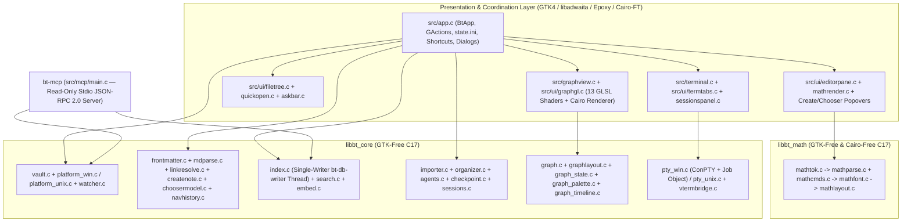
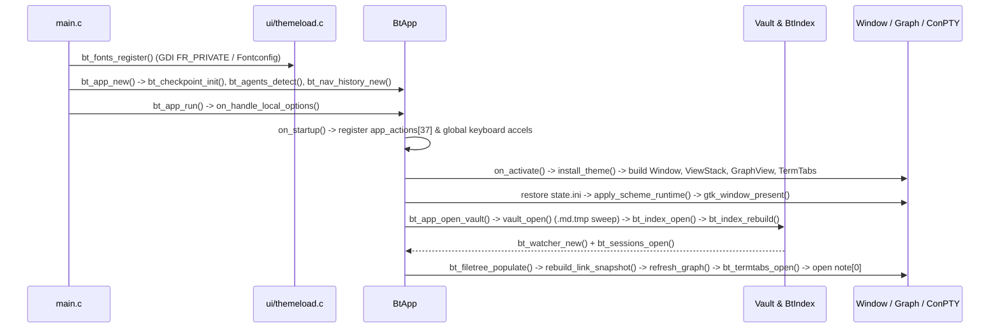
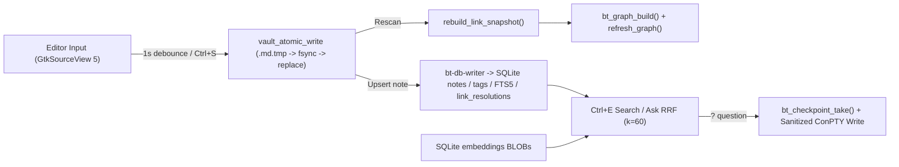

# BrainTerm — Architecture & Internals Handbook

## 1. Repository Structure & Compile-Time Layering

BrainTerm enforces strict compile-time decoupling across Meson targets (`meson.build`, `src/meson.build`, `src/math/meson.build`, `tests/meson.build`). Both domain logic (`libbt_core.a`) and mathematical typesetting (`libbt_math.a`) build free of GTK4 headers so `bt-mcp.exe` and non-UI test suites compile and execute cleanly without GUI toolkits.

| Directory | Contents & Responsibility |
|---|---|
| `src/` | Shared GTK-free static library `libbt_core.a` (`25` shared C modules + `2` OS platform/PTY adapters) plus GTK coordinators (`main.c`, `app.c`, `terminal.c`, `graphview.c`) |
| `src/math/` | Standalone GTK-free, Cairo-free LaTeX math library `libbt_math.a` (`mathtok.c`, `mathcmds.c`, `mathparse.c`, `mathfont.c`, `mathlayout.c`) |
| `src/ui/` | GTK4 / `libadwaita` / Epoxy widgets (`editorpane.c`, `filetree.c`, `askbar.c`, `quickopen.c`, `createpopover.c`, `chooserpopover.c`, `termtabs.c`, `sessionspanel.c`, `mathrender.c`, `graphgl.c`, `graphcapture.c`, `themeload.c`) |
| `src/mcp/` | Standalone read-only stdio JSON-RPC 2.0 server `bt-mcp` (`main.c`), linking only `libbt_core.a` |
| `migrations/` | Versioned SQLite schemas (`0001_init.sql` tables + FTS5 triggers; `0002_links_resolution.sql` persisted link resolutions) |
| `data/` | Compiled GResource payload (`theme.css`, `bt-markdown.lang`, `bt-ink-{dark,light}.xml`, `13` `.glsl` shaders, `16` symbolic `.svg` icons, `4` OFL fonts + `3` license texts) |
| `scripts/` | Build stamp emitter (`gen_build_stamp.py`), SVG icon generator (`gen_icons.py`), atomic Windows packager (`package-win.ps1`) |
| `tests/` | `39` C/H test & bench files under `unit/` (`28` targets), `crash-rig/` (`1`), `vtcorpus/` (`1`), `bench/` (`7`), plus fixture vaults |
| `vault-template/` | Starter Vault template (`AGENTS.md`, `CLAUDE.md`, `.gemini/settings.json`, `.gitignore`, `examples/*.md`) |
| `docs/` | Project rules (`project.md`), ADRs (`DECISIONS.md`), release docs (`DEVELOPMENT_STATUS.md`, `KNOWN_LIMITATIONS.md`, `RELEASE_CHECKLIST.md`, `ROADMAP.md`, `THIRD_PARTY_LICENSES.md`), specs, evidence, and reports |

**Compiled Shader & Asset Inventory (`data/brainterm.gresource.xml`):**
- **Backdrop & Bloom GLSL Shaders (`5`):** `graph_bg.vert.glsl`, `graph_bg.frag.glsl`, `graph_bloom_extract.frag.glsl`, `graph_bloom_blur.frag.glsl`, and `graph_bloom_composite.frag.glsl`.
- **Geometry & Label GLSL Shaders (`8`):** `graph_node.{vert,frag}.glsl`, `graph_edge.{vert,frag}.glsl`, `graph_label.{vert,frag}.glsl`, and `graph_dust.{vert,frag}.glsl`.
- **Bundled OFL Fonts (`data/fonts/`):** `InterVariable.ttf` (UI labels), `JetBrainsMono-Regular.ttf` / `JetBrainsMono-Bold.ttf` (editor/code/VT grid), `STIXTwoMath-Regular.otf` (HarfBuzz formulas), plus `LICENSE-Inter.txt`, `OFL-JetBrainsMono.txt`, and `LICENSE-STIXTwoMath.txt`.
- **Symbolic Iconography (`16` SVGs):** `bt-agent`, `bt-check`, `bt-editor`, `bt-fit`, `bt-folder`, `bt-git`, `bt-graph`, `bt-menu`, `bt-note`, `bt-plus`, `bt-reset`, `bt-search`, `bt-sessions`, `bt-sidebar`, `bt-zoom-in`, and `bt-zoom-out` (`-symbolic.svg`).

---

## 2. Verified Technology Stack (`MSYS2 UCRT64` & `meson.build`)

| Technology | Verified Version | Subsystems & Role | Operational Notes |
|---|---|---|---|
| **C17 (`gcc` / `meson` / `ninja`)** | `gcc 16.1.0`, `meson >= 1.1` | Core implementation (`-Wall -Wextra -Wpedantic -Wshadow -Wformat=2`, CI `-Dwerror=true`) | MSYS2 UCRT64 lacks `-lasan` / `-lubsan` archives |
| **GLib / GIO** | `2.88.2-1` | Data types, `GThread`, `GAsyncQueue`, `GFileMonitor`, `GKeyFile`, `GSubprocess` | Required across all libraries and executables |
| **GTK4 & libadwaita** | `4.22.4-1` / `1.9.1-1` | Windowing, `AdwOverlaySplitView`, `AdwViewStack`, `GtkGLArea`, dialogs (`bt` only) | Pinned API floor: `gtk4 >= 4.10`, `libadwaita >= 1.4` |
| **GtkSourceView 5** | `5.18.0-1` | Markdown syntax (`bt-markdown.lang`), gutter line numbers, `GtkSourceSearchContext` | Required (`bt`) |
| **SQLite 3** | `3.53.3-1` | Single-writer WAL store, `unicode61` FTS5 table, vector BLOB storage | Required (`bt` & `bt-mcp`) |
| **libyaml** | `0.2.5-2` | YAML frontmatter scanner & lossless unknown-key serialization (`frontmatter.c`) | Required; `256 KiB` header cap enforced |
| **md4c** | `0.5.3-1` | CommonMark SAX extractor -> H1, plain text, tags, wikilinks (`mdparse.c`) | Required |
| **cJSON** | `1.7.19-1` | `.bt/*.json`, `.brainterm/folder-colors.json`, importers, MCP JSON-RPC | Required |
| **libvterm** | `0.3.3-1` | ANSI/VT parser maintaining compact `16`-byte `BtCell` arrays (`vtermbridge.c`) | Required; OSC 52 clipboard kept off |
| **libgit2** | `1.9.4-1` | In-process git init, tree commits, commit history, diffs, hard rollback (`checkpoint.c`) | Required; halts cleanly on `.git/index.lock` (`R10`) |
| **HarfBuzz + FreeType + Cairo** | `14.2.1` / `2.14.3` / `1.18.4` | OpenType `MATH` shaping (`libbt_math`), Cairo-FT glyph cache, Cairo 2D graph & VT grid | Required |
| **libepoxy** | `1.5.10-7` | OpenGL 3.3 Core / GLES 3.0 shaders + Gaussian bloom FBOs (`graphgl.c`) | Required (`bt`); automatic Cairo fallback |
| **ConPTY / POSIX `forkpty`** | Win10 1809+ / Linux | Platform PTY spawning, resize & tree kill (`pty_win.c`, `pty_unix.c`) | `pty_unix.c` untested interactively locally |
| **CMocka** | `1.1.8-3` | Automated unit, crash-rig, VT corpus, and headless UI verification suite | Optional (`-Dtests=true`) |

---

## 3. High-Level Layered Component Architecture

### Architectural & Concurrency Discipline
- **Strict Acyclic Dependency Chain:** `libbt_math` <- `libbt_core` <- `{bt UI shell, bt-mcp}`. Pure C core modules compile completely without GTK4 or Cairo headers.
- **Minor Retained Legacy Helpers:** Early M1 link helpers remain in `src/noteutil.c` strictly for `test_noteutil` backwards compatibility while all production UI/DB/graph paths use `src/linkresolve.c`.
- **Thread & Lock Topology:**
  - **GTK4 Main Loop:** Owns all UI widgets, debounced autosaves, `GFileMonitor` callbacks, link snapshot swaps, and GL/Cairo draw calls.
  - **`bt-db-writer` Thread (`ADR-007`):** Dedicated worker draining a `GAsyncQueue` for all SQLite WAL writes and synchronous reads (`index.c`).
  - **Vault Write `G_LOCK`:** Serializes `.md.tmp` exclusive creation, flush, and atomic file replacement (`vault_atomic_write()`).
  - **PTY Worker Threads (`pty_win.c`):** Dedicated blocking reader (`512 KB` ring -> `256 KB` GLib high-priority drain) and writer (`1 MB` non-blocking cap) threads under a Win32 Job Object.
- **API Floor & Token Discipline:** Supports `gtk4 >= 4.10` / `libadwaita >= 1.4` and enforces 1:1 hex + WCAG AA contrast parity between `data/theme.css` and `src/theme.h`.
- **Subsystem Communication Contract:** UI widgets never touch SQLite directly or bypass `vault_resolve()`; background mutations communicate back exclusively via main-loop callbacks or synchronous queue results.
- **Snapshot Immutability:** `BtIndexSnapshot` builds immutable hash lookup tables (`rebuild_link_snapshot()`) on opens, saves, renames, deletes, and external reloads so click checks avoid partial DB states.
- **Zero-Idle Graph Convergence:** `BtGraphView` stops GTK frame clock redraw ticks automatically once `BtGraphLayoutState` reaches equilibrium or transitions finish (`0` idle CPU overhead).
- **MCP Process Boundary:** `bt-mcp.exe` runs in a completely separate OS process linking only `libbt_core.a` and opening `.bt/index.db` read-only via SQLite WAL without GUI locks.
- **Font Registration Boundary:** Private GDI (`FR_PRIVATE`) / Fontconfig registration executes in `bt_fonts_register()` prior to GTK window creation so GtkSourceView and HarfBuzz locate fonts deterministically.
- **Safe Build-Stamp Provenance:** `scripts/gen_build_stamp.py` injects `BT_BUILD_STAMP` cleanly at build time without modifying tracked repository source files.
- **Graceful Teardown Invariant:** `bt_app_free()` cancels timers, flushes dirty buffers, kills child PTYs within `2000 ms`, frees `link_snap` before child widgets, joins `bt-db-writer`, and shuts down `libgit2`.
- **Error Propagation Boundary:** Core APIs report structured `BT_ERROR` codes rather than aborting (`BT_ERROR_PATH_REJECTED`, `IO`, `NOT_FOUND`, `ENCODING`, `INVALID`).
- **Crash-Safe Recovery Invariant:** `vault_open()` cleans `.md.tmp` debris (`R1`), `bt_index_open()` rebuilds corrupt indexes (`R2`), and `organizer.c` backs up corrupt `.bt/dismissed_tags.json` to `.bak`.
- **Read-Only Opening Invariant:** `vault_open_readonly()` suppresses `.md.tmp` deletes and `.bt/vault.log` writes for `bt-mcp` and diagnostics.
- **Human Data Priority (`P4`):** Automation isolates proposals into `tags_ai` and `inbox/import/`, refusing overwrites on human locks (`R9`) or locked git states (`R10`).

---

## 4. Detailed Module-Level Specifications

### 4.1 Vault Filesystem, Platform Adapters & Watcher (`vault.c`, `platform_*.c`, `watcher.c`)
- **Modules:** `src/vault.c`, `src/platform_win.c`, `src/platform_unix.c`, `src/watcher.c`.
- **Path Containment (`vault_resolve()`):** Normalizes `/` separators, rejects empty/absolute inputs, drive prefixes, UNC paths, NTFS ADS (`:`), Win32 reserved names (`CON`, `PRN`, `AUX`, `NUL`, `COM1..9`, `LPT1..9`), control characters, and `..`.
- **Canonical Check:** Resolves filesystem paths via `bt_platform_realpath()` and rejects symlink or junction escapes with `BT_ERROR_PATH_REJECTED`.
- **Atomic Commits (`vault_atomic_write()`):** Serializes writes under a `G_LOCK`, creates `.md.tmp` exclusively, flushes file handles, and replaces atomically (`MoveFileExW` / POSIX `rename()` + `bt_platform_fsync_dir()`).
- **Opening Modes (`R1`):** `vault_open()` deletes stale `*.md.tmp` write debris, whereas `vault_open_readonly()` leaves all disk state untouched for MCP read safety.
- **External Change Watcher (`watcher.c`):** Debounces `GFileMonitor` bursts over `500 ms` on the GLib main loop, falls back to `BT_WATCH_STORM_RESCAN` at `>= 500` events (`R4`), and classifies clean/dirty drift via `bt_conflict_decide()` (`R3` `body_hash`).

### 4.2 Parsing, Wikilinks, Note Creation & History (`frontmatter.c`, `mdparse.c`, `linkresolve.c`, `createnote.c`, `choosermodel.c`, `navhistory.c`)
- **YAML Frontmatter (`frontmatter.c`):** Bounds YAML slices at **`256 KiB`**, extracts metadata via `libyaml`, detects duplicate keys (`R9`), and preserves custom keys verbatim (`BtUnknownField`) across edits.
- **CommonMark Extractor (`mdparse.c`):** Traverses `md4c` AST callbacks in a single pass emitting `first_h1`, `plain_body` for FTS5 indexing, `#tags`, and `[[wikilinks]]` excluding code blocks.
- **Link Resolution (`linkresolve.c`):** `bt_link_scan()` skips code/math spans before `bt_link_resolve()` matches immutable `BtIndexSnapshot` hashtables (`RESOLVED`, `AMBIGUOUS`, `UNRESOLVED`, `EXTERNAL`, `BLOCKED`, `PLACEHOLDER`).
- **Safe Create & Chooser (`createnote.c`, `choosermodel.c`):** `bt_createnote_commit()` validates `<= 240 B` segments / `<= 1024 B` paths and uses non-overwriting atomic commits (`MoveFileExW` without replace / `link`+`unlink`); `BtChooserModel` manages 10-row candidate selection.
- **Navigation Sync (`navhistory.c`):** Maintains a bounded 100-entry jump ring (`relpath`, `caret_offset`, `scroll_y`); `bt_nav_history_rename_path()` and `remove_path()` update stored entries immediately when notes rename or delete.

### 4.3 SQLite Writer Thread, Search & Offline Embeddings (`index.c`, `search.c`, `embed.c`)
- **Single-Writer Thread (`ADR-007`):** `bt_index_open()` runs `PRAGMA integrity_check` (`R2` rebuild on corruption; refuses newer schemas) and launches thread `bt-db-writer` processing typed synchronous requests over a `GAsyncQueue`.
- **SQLite Query Surface:** Exposes FTS5 `bm25()` + `snippet()`, note/edge/resolution upserts, `recent` (`ORDER BY updated DESC`), `orphan_notes`, `pending_ai_tags`, `backlinks`, `embeddings`, and `embedding_count()`.
- **Search Classifier & Prompt Builder (`search.c`):** Distinguishes Search / `?Ask` / `>Command` prefixes (`BtAskMode`) and formats sanitized agent commands via `bt_search_compose_ask_agent_cmd_for()` + `append_sanitized()`.
- **128-Dim Lexical Embeddings (`embed.c`):** Encodes lowercased words (`+/-2.0f`) and trigrams (`+/-1.0f`) via FNV-1a into L2-normalized `BT_EMBED_DIM = 128` floats, checks `vec_is_finite()` / `isfinite()` on SQLite BLOBs (`vault == NULL` safe), and merges ranks via RRF (`k = 60`).

### 4.4 Automation, Checkpoints, Sessions, Importers & Organizer (`checkpoint.c`, `sessions.c`, `agents.c`, `importer.c`, `organizer.c`)
- **Git Snapshots & Sessions (`checkpoint.c`, `sessions.c`):** `checkpoint.c` drives `libgit2` init/commit/log/diff/rollback (`BT_OID_HEX_LEN`) while refusing `.git/index.lock` (`R10`); `sessions.c` syncs `.bt/sessions.json` and SQLite `sessions`.
- **CLI Launchers (`agents.c`):** Probes `claude`, `codex`, and `gemini`, deploys starter agent files without overwriting customized `AGENTS.md`, and masks `'%'`, `'\''`, `'!'`, and POSIX metachars (`sanitize_title_literal()`).
- **Importers (`importer.c`):** Enforces `64 MiB` read bounds (`read_import_file_bounded()`), YAML-escapes titles, hashes non-ASCII slugs (`untitled-%.6s`), and flags 0-object JSONL inputs invalid.
- **Auto-Tagger (`organizer.c`):** Writes solely to `tags_ai`, respects `P4` human locks, preserves corrupt `.bt/dismissed_tags.json` as `.bak`, and halts cleanly on malformed YAML (`R9`) or `.git/index.lock` (`R10`).

### 4.5 Brain Graph Engine & Dual Renderers (`graph*.c`, `graphview.c`, `ui/graphgl.c`)
- **Topology & Pure-C 2D Layout (`graph.c`, `graphlayout.c`):** `graph.c` pairs one node per note alongside folder/tag/session/import/ghost nodes; `graphlayout.c` solves spatial-grid forces (`0x5A17C0DEu`), packs connected components, builds an outer halo ring, eliminates disc overlaps (`rem_overlaps == 0`), and supports pin/reheat.
- **Picking, Palette & Modes (`graph_state.c`, `graph_palette.c`, `graph_timeline.c`):** Powers Z-sorted grid picking, fisheye hover spread, 4-arm Galaxy spirals, 12 Andromeda folder colors (`.brainterm/folder-colors.json`), and `Organic`/`Kept` timelines.
- **OpenGL & Cairo Backends (`ui/graphgl.c`, `graphview.c`):** `graphgl.c` draws instanced nodes, Bézier edges, bloom FBOs, and cached `2048x1024` Pango atlases, using `bt_graph_gl_mark_positions_dirty()` during drag/settle to skip Pango rasterization; Cairo mirrors matching views cleanly when GL is unavailable or overridden.

### 4.6 PTY Transport, VT Mirror, Math & MCP (`pty_*.c`, `vtermbridge.c`, `src/math/*`, `src/mcp/main.c`)
- **ConPTY & POSIX PTY (`pty_win.c`, `pty_unix.c`):** `pty_win.c` wraps ConPTY inside `JOB_OBJECT_LIMIT_KILL_ON_JOB_CLOSE` using reader (`512 KB` ring -> `256 KB` GLib high-priority drain) and writer (`1 MB` cap) threads; `pty_unix.c` runs `forkpty` with `kill(-pid)`.
- **VT State Mirror (`vtermbridge.c`):** Mirrors VT output into compact `16`-byte `BtCell` arrays (`10,000` default / `100k` max scrollback; OSC 52 disabled).
- **Math Engine (`src/math/*`, `ui/mathrender.c`):** Tokenizes delimiters ahead of emphasis, parses bounded ASTs (`5,000` nodes, depth `64`), reads `STIXTwoMath-Regular.otf` via HarfBuzz, and feeds a `512`-slot Cairo-FT cache.
- **Read-Only MCP (`src/mcp/main.c`):** Links `libbt_core.a` only, opens vault/SQLite read-only (`vault_open_readonly()`, `bt_index_open_readonly()`), parses `<= 8 MiB` JSON-RPC lines, and executes query-only tools (`-32601` on escapes/writes).

### 4.7 GTK4 Presentation Widgets (`src/app.c`, `src/ui/*`)
- **`BtApp` (`src/app.c`):** Owns main window state, `37` `GAction` entries, `state.ini` persistence, keyboard shortcuts modal, Ask/Import/Review-Tags/Backlinks dialogs, and rollback synchronization.
- **Editor & Navigation UI (`src/ui/*`):** `editorpane.c` (Markdown buffer, Find/Replace, conflict banner), `filetree.c` (vault tree), `askbar.c` (3-mode bar + 10-entry history), `quickopen.c` (`Ctrl+P` fuzzy switcher), and `createpopover.c` / `chooserpopover.c` (link prompts).
- **Terminal, Graph & Theme UI (`src/ui/*`):** `termtabs.c` (8-tab PTY host), `sessionspanel.c` (resume/rollback panel), `graphgl.c` / `graphcapture.c`, and `themeload.c` (Dusk CSS + private font registration).

---

## 5. Application Startup & Shutdown Lifecycles

### Startup & Shutdown Sequence Details
1. **Pre-UI Initialization:** `main()` registers private OFL fonts via `bt_fonts_register()` prior to GTK initialization; `bt_app_new()` starts `libgit2`, probes CLI tools (`claude`, `codex`, `gemini`), and allocates `BtNavHistory`.
2. **Headless CLI Fast-Path:** `on_handle_local_options()` executes `--version` and `--selftest-links <vault>` cleanly without initializing GTK displays.
3. **Action & Window Setup:** `on_startup()` binds all `37` `GAction` items and accelerators; `on_activate()` applies Dusk CSS, builds panes, restores `state.ini` toggles, and maps the main window.
4. **Deterministic Vault Opening (`bt_app_open_vault()`):** Deploys starter agent templates (protecting `AGENTS.md`), launches `bt-db-writer`, rebuilds FTS5, constructs `link_snap`, builds Brain Graph, spawns tab `1`, and loads note `0`.
5. **Ordered Shutdown (`on_window_close()` -> `bt_app_free()`):** Flushes dirty edits (`bt_editorpane_flush_save()`), closes terminal PTYs within `2000 ms`, cancels idle callbacks, clears `link_snap` before widget teardown, joins `bt-db-writer`, and shuts down `libgit2`.

---

## 6. Runtime Data Flows, State Ownership & Error Propagation

### State Ownership & Error Classification
- **Authoritative User Data (`L0`):** Vault `.md` note files and YAML frontmatter (never mutated destructively by automation).
- **Application Preferences (`state.ini`):** Stored in `%LOCALAPPDATA%/brainterm/state.ini` (or `$BT_CONFIG_DIR/state.ini`), persisting vault path, theme scheme, editor toggles, `hybrid_enabled`, `preferred_cli`, and Brain Graph modes/styles/filters.
- **Rebuildable SQLite Cache:** `<vault>/.bt/index.db` (`WAL` mode, FTS5 `notes_fts`, `link_resolutions`, `embeddings`, `sessions`).
- **Vault Sidecar State:** `<vault>/.bt/{sessions.json,dismissed_tags.json,.bak,vault.log}` and `<vault>/.brainterm/folder-colors.json`.
- **Transient Session State:** Undo/redo stacks, dirty editor text, 100-jump `BtNavHistory`, `BtVTerm` cell arrays, GL vertex buffers, active `BtGraphLayoutState`, Ask Bar 10-entry history, and session URL skip consent.
- **Error Domain (`BT_ERROR`, `src/bterror.h`):** Core C functions return structured `BT_ERROR_PATH_REJECTED`, `IO`, `NOT_FOUND`, `ENCODING`, and `INVALID` codes; lock hazards (`R9`/`R10`) abort writes cleanly while corrupt caches rebuild (`R2`) or save `.bak` backups.
