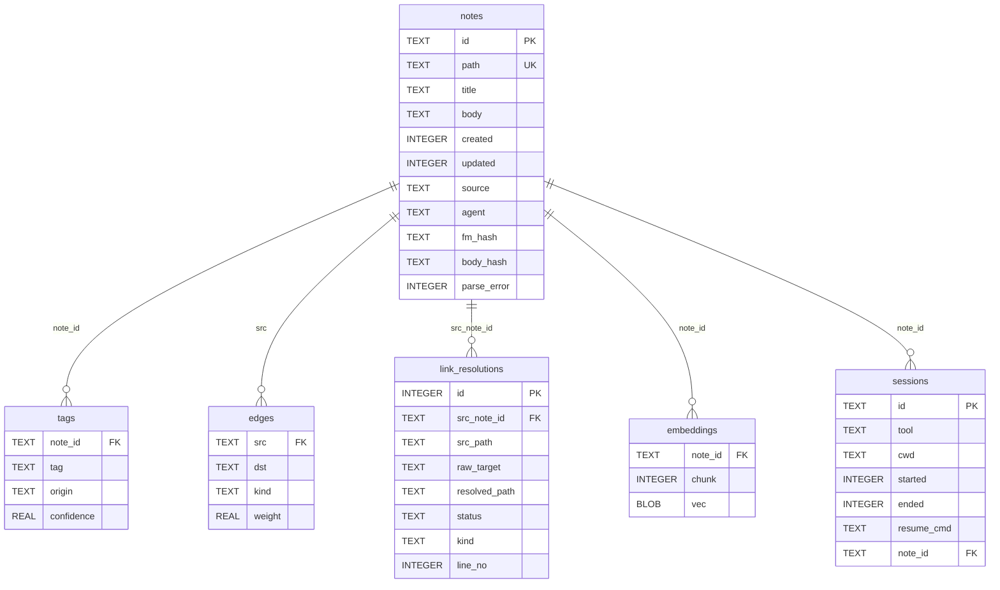

# BrainTerm — Technical Feature-by-Feature Reference

This guide specifies all 16 implemented subsystems verified directly in BrainTerm's C17 source code (`2026-11-27`). Unimplemented specifications ([docs/logseq-parity.md](../../logseq-parity.md) `P1–P9`: outliner blocks, tasks/DEADLINE, Datalog/properties, journals, flashcards, static export) remain deferred outside active functionality.

## Subsystem Status Matrix
| # | Subsystem | Verification Status | Primary Sources | Persisted / Derived Storage |
|---|---|---|---|---|
| 1 | Vault & Filesystem Engine | **PASS** | `src/vault.c`, `src/platform_win.c`, `src/platform_unix.c` | `L0 .md` files, `.bt/vault.log` |
| 2 | Watcher & Conflict Resolution | **PASS** | `src/watcher.c` | Transient editor conflict banner |
| 3 | Editor, Find/Replace & Onboarding | **PASS** | `src/ui/editorpane.c`, `data/language-specs/bt-markdown.lang` | `L0 .md` files, `state.ini` |
| 4 | YAML Frontmatter & MD4C Parser | **PASS** | `src/frontmatter.c`, `src/mdparse.c` | YAML frontmatter block, FTS5 body |
| 5 | Links, Note Creation, Chooser & History | **PASS** | `src/linkresolve.c`, `src/createnote.c`, `src/choosermodel.c`, `src/navhistory.c` | SQLite `link_resolutions`, memory ring |
| 6 | SQLite Database & Migrations | **PASS** | `src/index.c`, `migrations/` | `<vault>/.bt/index.db` (`WAL`) |
| 7 | Search Engine & Offline Vectors | **PASS** *(Lexical)* | `src/search.c`, `src/embed.c`, `src/ui/askbar.c` | SQLite `notes_fts`, `embeddings` BLOBs |
| 8 | Brain Graph (`2D Clean/Glow`, `3D`, `Galaxy`, `G3`) | **PASS** | `src/graph*.c`, `src/graphview.c`, `src/ui/graphgl.c` | `state.ini`, `.brainterm/folder-colors.json` |
| 9 | Timeline View | **PASS** | `src/graph_timeline.c` | `state.ini`, derived ledger milestones |
| 10 | Embedded Terminal (`ConPTY` / `forkpty`) | **PASS (Windows)** | `src/pty_win.c`, `src/pty_unix.c`, `src/vtermbridge.c`, `src/ui/termtabs.c` | Volatile `BtVTerm` screen/scrollback |
| 11 | AI Agent Launchers & Checkpoints | **PASS** | `src/agents.c`, `src/checkpoint.c`, `src/sessions.c` | `.git/` commits, `.bt/sessions.json` |
| 12 | AI Auto-Organization | **PASS** *(`LOCAL_MODEL` stub)* | `src/organizer.c` | `tags_ai`, `.bt/dismissed_tags.json` |
| 13 | Chat Importers & Export Scope | **PASS** *(Export deferred)* | `src/importer.c` | `inbox/import/<tool>/*.md` |
| 14 | OpenType Mathematical Typography | **PASS** | `src/math/*`, `src/ui/mathrender.c` | In-memory 512-entry Cairo cache |
| 15 | Read-Only MCP Bridge (`bt-mcp`) | **PASS** | `src/mcp/main.c` | Read-only reads of `L0` & `index.db` |
| 16 | Settings, Accessibility & Dusk Theme | **PASS** | `src/theme.c`, `src/ui/themeload.c`, `src/app.c` | `state.ini` (`$BT_CONFIG_DIR`) |

---

## 1. Vault & Filesystem Engine (`src/vault.c`, `src/platform_*.c`)
- **Purpose:** Manage plain-Markdown vault directories (`L0`) safely across Windows and POSIX hosts.
- **Core Entrypoints:** `vault_open()`, `vault_open_readonly()`, `vault_notes()`, `vault_resolve()`, `vault_atomic_write()`, `vault_rename_note()`, `vault_delete_note()`.
- **Path Security Guard (`vault_resolve()`):** Normalizes `/` separators, rejects empty/absolute inputs, drive prefixes, UNC paths, NTFS ADS (`:`), Win32 device names (`CON`, `PRN`, `AUX`, `NUL`, `COM1..9`, `LPT1..9`), control characters, and `..`.
- **Canonical Verification:** Resolves targets via `bt_platform_realpath()` and blocks symlink or junction escapes with `BT_ERROR_PATH_REJECTED`.
- **Atomic Commits (`R1`):** Serializes writes under `G_LOCK`, creates `.md.tmp` exclusively, flushes file handles, and atomically commits (`MoveFileExW(MOVEFILE_REPLACE_EXISTING | MOVEFILE_WRITE_THROUGH)` on Windows; `rename()` + `bt_platform_fsync_dir()` on POSIX).
- **Read-Only vs Writable Opening:** `vault_open()` sweeps leftover `*.md.tmp` write debris, whereas `vault_open_readonly()` suppresses temporary file cleanup and `.bt/vault.log` creation.
- **Crash-Rig & Mutation Guards:** Hooks `BtWriteStage` for `crashrig_r1`; `vault_rename_note()` supports case-only renames safely; `vault_delete_note()` rejects directories cleanly.

---

## 2. File Watcher & External Conflict Resolution (`src/watcher.c`)
- **Purpose:** Surface external disk changes and deletions in active vaults without disrupting typing.
- **Entrypoints:** `bt_watcher_new()`, `bt_conflict_decide()`, `bt_watcher_audit_drift()`.
- **Debounced Monitoring:** Coalesces `GFileMonitor` bursts over `BT_WATCHER_DEBOUNCE_MS = 500 ms` on the GLib main loop.
- **Storm Protection (`R4`):** Switches automatically to `BT_WATCH_STORM_RESCAN` when event bursts reach `BT_WATCHER_STORM_THRESHOLD = 500`.
- **Unchanged & Clean Buffers (`R3`):** Maps identical `body_hash` -> `BT_CONFLICT_NOOP`, and modified files with clean editor buffers -> `BT_CONFLICT_SILENT_RELOAD`.
- **Dirty Buffer / Deletion Banner:** Displays non-destructive banner buttons (`Review diff`, `Keep mine`, `Reload`) so unsaved prose is never overwritten silently.

---

## 3. Markdown Editor & Find/Replace (`src/ui/editorpane.c`, `data/language-specs/bt-markdown.lang`)
- **Purpose:** Render a focused distraction-free `.md` authoring editor on top of `GtkSourceView 5`.
- **Syntax & Theme Rules:** Applies custom `bt-markdown.lang` rules (YAML headers, `[[wikilinks]]`, `#tags`, LaTeX spans, `## AI draft`) with `bt-ink-{dark,light}.xml`.
- **Ergonomic Formatting:** Pads text into a ~72ch readable reading column with toggleable line numbers (`[editor] show_line_numbers`).
- **Autosave & Flush:** Saves modified buffers via `Ctrl+S`, navigation jumps, or `1 s` idle debounce into `vault_atomic_write()`.
- **In-Document Find (`Ctrl+F`):** Opens `#bt-find-bar` in find-only mode (`bt_editorpane_show_find(pane, FALSE)`) with `GtkSourceSearchContext`, live match count, and `search-match` style highlights (`Esc` closes).
- **In-Document Replace (`Ctrl+H`):** Expands `#bt-replace-row` exposing `Replace`, `Replace All`, and `Case sensitive` toggles.
- **Empty-State Onboarding:** Displays inline `Open Vault…` and `Create Starter Vault…` actions whenever no vault is open (`bt_editorpane_set_has_vault()`).

---

## 4. Markdown Parsing & YAML Frontmatter (`src/frontmatter.c`, `src/mdparse.c`)
- **Purpose:** Parse YAML metadata and CommonMark note structures accurately without external scripts.
- **YAML Framing & Size Ceiling (`frontmatter.c`):** Validates leading `--- ... ---` bounds capped at **`256 KiB`** (`ylen > 256u * 1024u` -> `parse_error = TRUE`).
- **Core Schema Fields:** Extracts `id`, `title`, `created`, `updated`, `source` (`human` | `ai` | `import`), `agent`, `tags`, `tags_ai`, `links`, and `aliases` via `libyaml`.
- **Duplicate Key Refusal (`R9`) & Preservation:** Flags duplicate YAML keys as `parse_error` and retains custom YAML fields verbatim (`BtUnknownField`) across `bt_frontmatter_serialize()`.
- **CommonMark Extractor (`mdparse.c`):** Runs single-pass `md4c` callbacks extracting `first_h1`, `plain_body` for FTS5 indexing, deduplicated `#tags`, and unique `[[wikilinks]]`.
- **Code Immunity:** Excludes inline code spans and fenced code blocks cleanly from tag and wikilink extraction.

---

## 5. Clickable Links, Safe Creation, Chooser & History (`linkresolve.c`, `createnote.c`, `choosermodel.c`, `navhistory.c`)
- **Span Scanning (`linkresolve.c`):** `bt_link_scan()` and `bt_link_scan_range()` emit sorted non-overlapping `BtLinkSpan` regions outside code and math ranges.
- **Resolution Outcomes & Ghosts (`link_resolutions` & Brain Graph):** `bt_link_resolve()` evaluates targets against immutable `BtIndexSnapshot` hashtables across six canonical outcomes persisted to SQLite `link_resolutions` and Brain Graph ghost nodes:
  - `RESOLVED`: Unique exact relative path or stem match opened directly in editor.
  - `AMBIGUOUS`: Multiple matching notes ranked by Stage-4 subtree affinity, launching `BtChooserPopover`.
  - `UNRESOLVED`: Valid vault note target not yet present on disk, launching `BtCreatePopover` confirmation or visible as a graph ghost node.
  - `EXTERNAL`: Valid `http`/`https`/`mailto` URI validated before `GtkUriLauncher` dispatch.
  - `BLOCKED`: Dangerous extension, path escape, or disallowed scheme rejected cleanly by `bt_link_check_open_policy()`.
  - `PLACEHOLDER`: Empty `[[ ]]` link token highlighted without creating files.
- **Click & Keyboard Navigation (`ADR-016`):** Single-click opens links (`links_open_on_click = true`) unless the caret rests inside the span (`Alt+Click` moves cursor; `Ctrl+Click` / `Ctrl+Enter` opens; `Ctrl+Alt+Right/Left` hops spans).
- **Launch Security Policy (`ADR-017`):** `bt_link_check_open_policy()` hard-blocks 32 dangerous executable/script extensions, restricts external URLs to `http`/`https`/`mailto` (`<= 2,048 B`), strips/warns on `user:pass@`, honors `confirm_external_urls`, and delegates via `GtkFileLauncher` / `GtkUriLauncher` with zero shell calls.
- **Create-Only New Notes (`createnote.c`, `ui/createpopover.c`):** Enforces `<= 240 B` segments / `<= 1024 B` paths and reserved Win32 names, writing 9-key frontmatter notes after `BtCreatePopover` confirmation via non-overwriting atomic rename (`MoveFileExW` without replace / `link`+`unlink`).
- **Disambiguation Chooser (`choosermodel.c`):** Displays up to 10 visible candidates (`+N more` footer) with wrap keyboard nav and `Ctrl+C` explicit `[[folder/name]]` copy (`P4`).
- **Navigation Sync (`navhistory.c`):** Keeps a 100-jump `(relpath, caret_offset, scroll_y)` stack (`Alt+Left`/`Right`, mouse `8`/`9`), updated synchronously via `bt_nav_history_rename_path()` and `remove_path()` on note rename/delete.

---

## 6. SQLite Database & Migrations (`src/index.c`, `migrations/`)

- **Schema & Triggers (`BT_SCHEMA_VERSION = 2`):** `0001_init.sql` creates relational tables and `notes_fts USING fts5(title, body, content='notes', tokenize='unicode61')` with `AFTER INSERT/DELETE/UPDATE` triggers.
- **Link Resolution Migration:** `0002_links_resolution.sql` adds persisted `link_resolutions` rows and `dst_status` indexes.
- **Single-Writer Thread (`ADR-007`):** Dedicated thread `bt-db-writer` serializes mutations and synchronous queries (`recent` `ORDER BY updated DESC`, `orphan_notes`, `pending_ai_tags`, `backlinks`, `embeddings`, `embedding_count()`).
- **Integrity Recovery (`R2`):** `bt_index_open()` verifies `PRAGMA integrity_check`, rebuilds corrupt databases from `.md` sources automatically, and refuses unknown future schema versions.

---

## 7. Search Engine & Optional Offline Embeddings (`src/search.c`, `src/embed.c`, `src/ui/askbar.c`)
- **Full-Text FTS5 Lookup:** `bt_index_search_fts()` scores keyword matches with SQLite `bm25()` and contextual `snippet()` excerpts.
- **Search & Command Classifier (`Ctrl+E`):** `bt_search_detect_mode()` switches across keyword Search, `?question` Ask, and `>` Command mode (`20` commands incl. `>import chats`, `>review ai tags`, `>sync embeddings`, `>organize vault`).
- **Ask Agent Prompt Formatting:** `bt_search_compose_ask_agent_cmd_for()` formats a previewed, sanitized command citing up to 5 top hits for the configured CLI agent.
- **Ask Bar Ergonomics:** Supports 10-entry query history (`Alt+Up`/`Down`), `Up`/`Down` list selection, active CLI agent badge, and persisted `Hybrid` switch (`[search] hybrid_enabled`).
- **128-Dim Lexical Hash Vectors (`src/embed.c`):** Encodes lowercased words (`+/-2.0f`) and character trigrams (`+/-1.0f`) via 32-bit FNV-1a hashing into L2-normalized **`BT_EMBED_DIM = 128`** floats.
- **Vault Embedding Sync:** `bt_embed_sync_vault()` saves chunk `0` BLOBs into SQLite `embeddings` and builds `similar` edges (`cos > 0.75`).
- **Cached Query & Non-Finite Guard:** `bt_embed_hybrid_search()` fetches SQLite vectors once per query (`vault == NULL` safe), guards against `NaN`/`Inf` floats via `vec_is_finite()`, and blends ranks via RRF (`k = 60`).
- **Limitation:** Built-in hashing matches lexical/trigram overlap rather than neural semantic synonyms.

---

## 8. Brain Graph Engine & Renderers (`src/graph*.c`, `src/graphview.c`, `src/ui/graphgl.c`)
- **Topology & Node Invariants (`graph.c`):** Enforces `1` primary node per indexed note alongside `BT_NODE_FOLDER`, `BT_NODE_TAG`, `BT_NODE_SESSION`, `BT_NODE_IMPORT_ROOT`, and `BT_NODE_GHOST`.
- **Interactive Filtering:** Toolbar toggles filter `Links`, `Tags`, `Ghosts`, `Pulse`, `Reduce motion`, `Orphans` (`O`), and `Color by: Folder | Type`.
- **2D Clean Force Solver (`src/graphlayout.c` `G1`):** Solves spatial-grid repulsion (`0x5A17C0DEu`), packs connected components, arranges small/orphan components on an outer halo ring, and guarantees zero overlaps (`rem_overlaps == 0`).
- **Obsidian-Style Clean vs Glow Presets (`G2`):** Switches cleanly between crisp flat discs (`BT_GRAPH_STYLE_CLEAN`) and atmospheric bloom (`BT_GRAPH_STYLE_GLOW`), persisted in `[graph] style`.
- **G3 Live Manipulation:** Supports 2D drag-to-pin, neighbor spring reheat (`bt_graph_layout_reheat()`), zero idle CPU redraw convergence, `Re-layout` (`R`), `Highlight Orphans` (`O`), and Pin/Unpin menus.
- **3D Cortex View (`src/graph_state.c`):** Renders hierarchical depth projections with uniform-grid Z-sorted picking (`bt_graph_pick_screen()`), local fisheye hover spread, and `Tab` stack cycling.
- **Galaxy View (`src/graph_palette.c`):** Builds 4 logarithmic spiral arms with core bulge shading, `3%` halo, differential rotation, `700 ms` animated morphs, and `12` Andromeda folder colors saved to `.brainterm/folder-colors.json`.
- **OpenGL & Cairo Backends (`src/ui/graphgl.c`):** OpenGL 3.3 Core / GLES 3.0 (`13` shaders) draws instanced nodes, Bézier edges, bloom FBOs, `2048x1024` Pango atlases, and fast position VBO updates (`bt_graph_gl_mark_positions_dirty()`); automatic fallback or `BRAINTERM_GRAPH_BACKEND=cairo` runs Cairo.

---

## 9. Timeline View (`src/graph_timeline.c`)
- **Purpose:** Plot vault notes alongside checkpoints, sessions, imports, and AI edits on a shared chronology axis.
- **Date & Swimlane Mapping:** `bt_timeline_build()` resolves frontmatter ISO-8601 dates (`bt_timeline_parse_date()`) or `updated` timestamps into `BT_TL_LANE_FOLDER` / `TYPE` swimlanes.
- **Organic & Kept Layouts:** Computes collision-free coordinates (`dist >= 2*r + 1 px`) across **Organic** (wavy beeswarm) and **Kept** (framed tidy grid) views.
- **Event Ledger:** Bottom track plots `BT_LEDGER_CHECKPOINT`, `SESSION`, `IMPORT`, and `AI_EDIT` milestones.
- **Brushing & Persistence:** Supports drag time-window filtering and persists active timeline settings in `state.ini`.

---

## 10. Embedded Terminal Subsystem (`src/pty_*.c`, `src/vtermbridge.c`, `src/ui/termtabs.c`)
- **Purpose:** Host real interactive shells rooted inside the vault directory without switching to external terminal windows.
- **Windows ConPTY (`pty_win.c`):** Spawns shells `CREATE_SUSPENDED` bound inside a Job Object (`JOB_OBJECT_LIMIT_KILL_ON_JOB_CLOSE`), pumping via dedicated reader (`512 KB` ring -> `G_PRIORITY_HIGH` `256 KB` GLib slice) and writer (`1 MB` ceiling) threads.
- **POSIX PTY (`pty_unix.c`):** Uses `forkpty()` + `g_io_add_watch_full` and `kill(-pid, SIGTERM/SIGKILL)` within `2000 ms` (awaiting interactive Linux QA).
- **VT State Mirror (`vtermbridge.c`):** Maps `libvterm` streams into compact `16`-byte `BtCell` structs (`10,000` default / `100k` max scrollback; OSC 52 disabled).
- **Tab Management (`termtabs.c`):** Caps active tabs at `8`, validates `cwd` via `vault_resolve()`, shows non-zero exit banners, and supports middle-click tab closure.
- **Focus & Scrollback:** Restores VTE keyboard focus cleanly after tab switches/closes and opens scrollback search on `Ctrl+Shift+F`.

---

## 11. AI Agent Integration & Checkpoints (`src/agents.c`, `src/checkpoint.c`, `src/sessions.c`)
- **Purpose:** Launch external AI CLIs cleanly over vault notes with deterministic git rollback protection.
- **Git Checkpoints (`checkpoint.c`):** Wraps `libgit2` init/commit/history/diff/rollback (`BT_OID_HEX_LEN`), halting cleanly on locked `.git/index.lock` (`R10`).
- **Rollback Sync:** Rebuilds FTS5 index, reloads active editor note if open, refreshes vault explorer, and updates Brain Graph automatically after rollback.
- **CLI Detection & Sessions (`agents.c`, `sessions.c`):** Probes `claude`, `codex`, and `gemini` on `PATH` and logs sessions to `.bt/sessions.json` + SQLite `sessions`.
- **Sanitized Injection:** Exports `TERM_PROGRAM=brainterm` + `BT_ACTIVE_NOTE` and injects prompts stripped of controls, `'%'`, `'\''`, `'!'`, and POSIX metachars.
- **Template Safety:** `bt_agents_apply_vault_template()` provisions starter agent instructions without overwriting existing `AGENTS.md`.

---

## 12. AI Auto-Organization (`src/organizer.c`)
- **Purpose:** Propose structured metadata tags automatically without overriding human authorship.
- **Execution Backends:** Supports `BT_ORG_NO_AI` heuristic keyword/folder scoring (default), `BT_ORG_CLI` (fixed-argv subprocess without shell expansion), and caller callback stub `BT_ORG_LOCAL_MODEL` (no embedded weights/runtime).
- **Human Ownership Governance (`P3`/`P4`):** Writes strictly to `tags_ai`, leaves human body prose untouched, and respects permanent human locks.
- **Interactive Review (`>review ai tags`):** Allows promoting AI suggestions into `tags` or permanently dismissing them into `.bt/dismissed_tags.json`.
- **Corruption & Lock Safety:** Saves corrupt `.bt/dismissed_tags.json` as `.bak` with `g_warning()` and aborts cleanly on malformed YAML (`R9`) or `.git/index.lock` (`R10`).

---

## 13. Importers & Static Export Status (`src/importer.c`)
- **Chat Transcript Ingestion (`>import chats`):** Parses ChatGPT/Claude `.json` exports and Claude Code/Codex `.jsonl` logs into `inbox/import/<tool>/YYYY-MM-DD-<slug>.md` (`source: import`).
- **Idempotency & Bounds:** Prevents duplicate re-imports of matching transcripts and enforces **`64 MiB`** read limits (`read_import_file_bounded()`).
- **Slugs & Malformed Input Protection:** YAML-escapes titles, creates `untitled-%.6s` FNV-1a slugs for pure Unicode headings, and returns `BT_ERROR_INVALID` on 0-object JSONL files.
- **Export Scope:** Batch HTML/PDF vault export ([docs/logseq-parity.md](../../logseq-parity.md) P7) remains unimplemented.

---

## 14. Mathematical Typography (`src/math/*`, `src/ui/mathrender.c`)
- **Purpose:** Render publication-grade inline `$...$` and display `$$...$$` LaTeX expressions inside the editor without external toolchains.
- **Delimiter Tokenizer (`mathtok.c`):** Scans `$...$`, `$$...$$`, `\(..\)`, `\[..\]`, and math environments before Markdown emphasis while skipping `$5` currency spans.
- **AST Bounds (`mathparse.c`, `mathcmds.c`):** Enforces arena caps (`4 KB`/`16 KB` input, depth `64`, `5,000` nodes, `20x20` matrix, `64` errors, dangerous macro blocklist).
- **OpenType Shaping (`mathfont.c`, `mathlayout.c`):** Queries HarfBuzz `MATH` font constants inside bundled `STIXTwoMath-Regular.otf`.
- **Rendering Cache (`mathrender.c`):** Caches up to `512` Cairo-FT rendered surfaces for fast cursor/scroll redraws.

---

## 15. Standalone Read-Only MCP Server (`src/mcp/main.c`)
- **Purpose:** Expose BrainTerm vault search and note context cleanly to external Model Context Protocol clients (Claude Desktop, Cursor).
- **Read-Only Isolation:** Links strictly `libbt_core.a`, opening vaults via `vault_open_readonly()` and SQLite via `bt_index_open_readonly()` with zero `.md.tmp` cleanup or `.bt/vault.log` writes.
- **Line Framing & Handshake:** Reads stdio JSON-RPC 2.0 requests dynamically up to **`8 MiB`** (`read_json_line()`) and advertises `initialize` (`readOnly:true`, `capabilities`).
- **Search & Query Tools:**
  - `search_memory`: Exposes `query`, `top_k` (integer), and `hybrid` (boolean) schema options backed by FTS5 and cached 128-dim vectors.
  - `ask_memory` & `recent`: Returns citation-grounded answer hits and chronologically ordered notes (`ORDER BY updated DESC`).
  - `get_note` & `backlinks`: Reads bounded note bodies and resolved incoming links through `vault_resolve()`.
- **Containment Enforcement:** Path traversal inputs (e.g., `../../etc/passwd`) and unimplemented write operations fail safely with `-32601`, while malformed payloads return `-32700`.

---

## 16. Settings, Accessibility & Theme Parity (`src/theme.c`, `src/ui/themeload.c`, `src/app.c`)
- **Theme Token Parity:** `test_theme` checks exact hex equality and WCAG AA contrast ratios between `data/theme.css` and `src/theme.h`.
- **Live Styling & Scheme Options:** Supports `BRAINTERM_CSS_DEV` hot reloading and runtime schemes (`Follow System`, `Dark (Ink)`, `Light (Paper — planned)`).
- **Persistent Config (`state.ini`):** Stores active vault path, scheme, `[editor] show_line_numbers`, `links_open_on_click`, `confirm_external_urls`, `[search] hybrid_enabled`, `preferred_cli`, and `[graph] style`/mode (`BT_CONFIG_DIR` isolated).
- **Keyboard Cheatsheet (`F1`):** Opens a searchable modal built without deprecated GTK 4.18 shortcut classes (`gtk4 >= 4.10` / `libadwaita >= 1.4` safe).
- **Accessible Semantics (`ATK`/`AT-SPI`):** Applies explicit `GTK_ACCESSIBLE_PROPERTY_LABEL` tags across icon-only header, sidebar, terminal tab close, and Brain Graph buttons, plus `"Vault notes"` on `#bt-filetree`.
